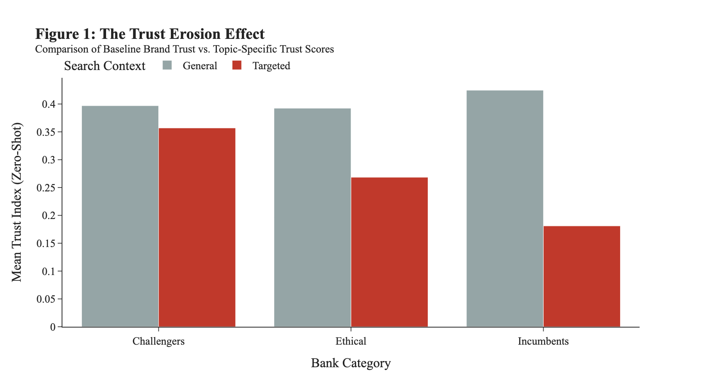

# Trust Erosion Delta (ΔT): how bank perception shifts under issue-specific news coverage

Research code for a manuscript under review, co-authored with Dr. Anu Sayal (Taylor's University). The study compares how six banks are portrayed in **general** news coverage versus coverage of **specific issues**: AI innovation and ethics, greenwashing, fossil-fuel financing, and data privacy. It then measures the gap as a per-bank *Trust Erosion Delta*.

## Design

| | |
|---|---|
| Banks | **Incumbents**: JPMorgan Chase, Deutsche Bank · **Challengers**: Nubank, Revolut · **Ethical**: Triodos Bank, Amalgamated Bank |
| Queries per bank | 1 *General* (control): `"<bank>" banking news` · 7 *Targeted* (treatment): AI innovation, AI transformation, AI bias, AI ethics, greenwashing, fossil fuel, data privacy |
| Sources | Google News, DuckDuckGo News, Yahoo Finance ticker news. Records are deduplicated by URL across all sources at ingest |
| Scoring (headline level) | **Sentiment**: FinBERT (`ProsusAI/finbert`), soft score P(positive) − P(negative) · **Trust index**: zero-shot `facebook/bart-large-mnli`, P(ethics, integrity, reliability) − P(scandal, fraud, controversy, risk) |
| Metric | **ΔT = mean trust index (General) − mean trust index (Targeted)**, per bank. Higher means trust drops more when coverage turns to specific issues |

## Data collection and coverage audit

Live news search returns uneven volumes, so the dataset is audited before any metric is computed:

1. **Initial collection:** 549 records (171 General, 378 Targeted).
2. **Coverage audit:** count records per bank × search term against a floor of 30. **38 of the 42 targeted cells** fell below it. Issue-specific coverage was thin for every bank, not just the smaller ones.
3. **Targeted back-fill** for those cells only, using a relaxed (unquoted) Google News query plus DuckDuckGo: **438 new records, 0 URL duplicates, 549 → 987 records.**
4. **Post back-fill check:** list the thinnest remaining search terms. Some topics remain genuinely sparse (see Limitations).

## Results (987 headlines, collected 18 Dec 2025)

| Category | Bank | ΔT (trust erosion) | Δ sentiment (Targeted − General) |
|---|---|---|---|
| Incumbents | Deutsche Bank | **0.398** | −0.346 |
| Challengers | Revolut | 0.154 | 0.022 |
| Ethical | Triodos Bank | 0.144 | 0.005 |
| Ethical | Amalgamated Bank | 0.133 | −0.250 |
| Incumbents | JPMorgan Chase | 0.085 | −0.100 |
| Challengers | Nubank | **−0.123** | 0.129 |

<p align="center"></p>

The perception matrix (financial sentiment against trust, one point per headline) is in [`figures/figure2_perception_matrix.png`](figures/figure2_perception_matrix.png).

## Limitations

- **Snapshot, not a panel.** Results reflect live search results on one day, so re-running the collection will return different articles.
- **Headlines only.** Scores use headlines, not article bodies. The zero-shot trust index is a proxy, not a validated trust measure.
- **No uncertainty estimates.** ΔT is a difference of means with no confidence interval or significance test, and General/Targeted sample sizes differ by bank.
- **Back-fill key inconsistency.** Google News back-fill records are stored with the *unquoted* search term, so the post back-fill audit splits one topic into two groups (for example `"Nubank" AI bias` and `Nubank AI bias`). ΔT is unaffected, because it groups by bank and query type, not by search term. Some cells remain below the floor (for example `"Triodos Bank" data privacy`).

## Files

| Path | Contents |
|---|---|
| [`trust_erosion_delta.ipynb`](trust_erosion_delta.ipynb) | Full pipeline with outputs from the original run (GPU). Installation and per-request logs trimmed; no numeric output changed |
| `figures/` | Static renders of the two plotly figures from the run's embedded figure data |

## Running it

```bash
python -m venv .venv && source .venv/bin/activate
pip install -r requirements.txt
jupyter lab trust_erosion_delta.ipynb
```

A GPU is recommended for the two transformer models. Collection uses randomised delays and retries to stay within the news services' rate limits.
